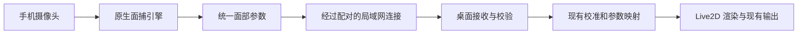

# VTubeLeaf 手机面捕伴侣 PRD

状态：v0.1 讨论稿 · 2026-10-12

适用范围：手机伴侣应用，以及桌面端接收手机面捕的配套能力。

本文承接「手机运行面捕，或作为电脑摄像头输入」的可行性讨论。用户已确认采用 Kotlin + Swift 原生实现，分别面向 Android 和 iOS；首发顺序、具体功能范围和验收数字仍为建议，尚未通过真机验证。本文扩展 [桌面产品 PRD](PRD.md) 的早期范围，不修改其中的历史决策记录。

## 1. 产品定位

手机负责拍摄和计算面部动作，通过局域网把动作参数传给电脑；电脑继续负责 Live2D 模型、参数调节、渲染和现有直播/会议输出。

用户把手机放在显示器附近，扫码连接电脑后，就能用手机驱动桌面的角色。摄像头原始画面留在手机，不需要账号、云端推理或公网连接。预期收益是减少电脑上的面捕计算，并提供可灵活摆放的摄像头；画质、动作准确度和总体功耗是否改善，需要同条件实测。

### 1.1 目标用户与场景

| 用户                       | 需求                     | 成功体验                                         |
| -------------------------- | ------------------------ | ------------------------------------------------ |
| 使用笔记本会议或直播的用户 | 让手机承担面捕计算       | 电脑保持角色渲染和输出，停止原本的摄像头面捕任务 |
| 桌面没有合适摄像头的用户   | 用已有手机取景           | 不需要购买摄像头或安装系统摄像头驱动             |
| 希望调整拍摄位置的主播     | 将手机固定在更适合的位置 | 能在手机上确认取景、跟踪和连接状态               |

### 1.2 两条路线的优先级

| 路线           | 手机职责                 | 电脑职责               | 建议                              |
| -------------- | ------------------------ | ---------------------- | --------------------------------- |
| 手机本地面捕   | 采集、推理、发送动作参数 | 映射、渲染、输出       | P0 主路线，直接验证计算转移的价值 |
| 手机摄像头输入 | 采集、编码、发送视频     | 解码、推理、渲染、输出 | 后续独立需求；首版不自建视频传输  |

单纯需要手机摄像头时，可以先验证系统现有能力，例如 [Apple 连续互通相机](https://support.apple.com/en-ie/102546) 或设备支持的 [Android USB 摄像头模式](https://source.android.com/docs/core/camera/webcam)。这些能力受系统和设备支持范围限制，不能作为全平台内置承诺；它们也不会自动把面捕推理转移到手机。

## 2. 范围与优先级

### 2.1 P0：跑通手机面捕到桌面输出

| 编号 | 能力             | 要求                                                                           |
| ---- | ---------------- | ------------------------------------------------------------------------------ |
| M-01 | 手机本地面捕     | 前置摄像头、单人、头部转动、左右眼开合、嘴部开合和微笑；缺失能力显式声明       |
| M-02 | 局域网配对       | 桌面显示二维码，手机扫码连接；一台电脑同时只接收一台已配对手机的面捕           |
| M-03 | 手机控制         | 取景预览、开始、暂停、断开；明确显示摄像头和发送状态                           |
| M-04 | 桌面输入源       | 新增手机输入源；切换来源后停止被替换的面捕任务，不同时运行两套面部推理         |
| M-05 | 校准与调节       | 复用桌面的中立姿态校准、映射、灵敏度和平滑；切换设备或引擎后提示重新校准       |
| M-06 | 故障恢复         | 区分无人脸、权限拒绝、网络断开、设备不支持、推理失败；能够恢复或给出具体下一步 |
| M-07 | 长时间使用       | 跟踪时保持屏幕唤醒，可隐藏本地预览；温度或负载导致降速时提示用户               |
| M-08 | 隐私与连接保护   | 原始视频留在手机；配对后才能发送参数；可以主动断开并撤销当前连接               |
| M-09 | 多语言与可访问性 | 与桌面相同的英、中、日、西、法五种语言；状态不能只靠颜色表达；控件有可读标签   |

Android 和 iOS 共用产品行为与协议，允许分阶段发布。首发平台在选定可持续测试的真机后确定；未经验证的平台不标记为已支持。

### 2.2 P1：首版稳定后按反馈追加

- 手动配对入口和可信设备记忆，减少再次连接的操作；不能绕过首次身份确认。
- 眼球、眉毛等附加参数，在引擎可提供且模型可表达时开放。
- 经实测有收益的性能档位、热状态下自动降档和更详细的连接诊断。
- 手机上的远程校准按钮；仍由桌面执行统一校准。

### 2.3 本期不包含

- 手机端 Live2D 模型库、模型渲染、直播推流、录制或桌面完整工作台。
- 自建手机视频流、系统虚拟摄像头驱动、USB 通信、公网中继或跨网络连接。
- 手部、全身、多人跟踪，以及麦克风音频传输。
- 后台或锁屏持续拍摄、账号体系、订阅和云同步。

## 3. 用户流程与页面

### 3.1 首次连接

1. 用户在桌面选择手机输入源，开启本次连接，看到二维码和同一局域网的提示。
2. 手机解释相机及局域网访问用途，按系统要求申请权限；扫描桌面二维码，显示目标电脑名称。
3. 手机与桌面完成带身份校验的配对；双方显示已连接，但尚未开始面捕。
4. 用户把手机固定好，在前置摄像头预览中确认取景，点击开始。
5. 桌面显示参数正在接收，用户在桌面做一次中立姿态校准，角色开始跟随。
6. 用户沿用现有桌面输出方式参加会议或直播。

扫描二维码结束后释放扫码摄像头，再启动面捕摄像头。手机不需要读取电脑模型，也不需要获得电脑文件访问权限。

### 3.2 页面最小集合

| 位置             | 内容与操作                                                                |
| ---------------- | ------------------------------------------------------------------------- |
| 手机连接页       | 扫码、连接中状态、目标电脑、失败原因和重试                                |
| 手机跟踪页       | 本地预览、是否发现人脸、连接状态、有效面捕帧率、开始/暂停、隐藏预览、断开 |
| 手机设置/说明页  | 语言、隐私说明、支持情况、版本和使用帮助                                  |
| 桌面现有面捕区域 | 手机来源选项、配对二维码、设备名、接收帧率、连接状态、校准、断开          |

隐藏预览只隐藏手机画面，摄像头仍工作；页面保留明显的跟踪状态。暂停会释放摄像头并停止推理和参数发送，保留控制连接；断开同时结束连接。进入后台、锁屏或相机被系统中断时按暂停处理，返回前台后由用户点击恢复。

桌面的来源选择只替换面部输入，不清空模型调节、场景或输出设置。已有手部、身体和语音功能需要明确独立来源；如果当前组合无法并存，应显示限制，不能静默重启电脑摄像头或另一套面部推理。

### 3.3 异常与恢复

以下时间为初始建议值，需在原型中校正。

| 情况                               | 用户看到什么                       | 系统行为                                                |
| ---------------------------------- | ---------------------------------- | ------------------------------------------------------- |
| 相机权限拒绝或被占用               | 原因和授权/关闭占用应用的指引      | 不反复弹权限申请，不进入假跟踪状态                      |
| 局域网访问被拒绝                   | 授权用途与系统设置入口指引         | 不将权限错误报告为目标电脑离线                          |
| 没有人脸或连续 500 ms 没有有效结果 | 手机提示调整位置，桌面显示跟踪丢失 | 约 1 秒内平滑回到中立状态，不无限冻结旧表情             |
| 短时断网                           | 正在重连                           | 仅重连同一已授权会话，丢弃积压帧；30 秒未恢复则暂停采集 |
| 配对失效、电脑关闭连接或用户断开   | 连接已结束，可重新扫码             | 停止重连，撤销当前凭据                                  |
| 手机锁屏、切到后台或来电中断       | 返回后显示已暂停                   | 释放摄像头，桌面进入跟踪丢失状态；恢复需用户操作        |
| 推理明显降速或温度过高             | 明确提示降低负载或暂时休息         | 不继续积压视频帧；触发系统保护时安全暂停                |
| 第二台手机尝试连接                 | 当前已有设备连接                   | 不抢占；需用户在桌面断开旧设备后配对                    |
| 协议版本不兼容或设备不支持         | 具体兼容要求或升级提示             | 拒绝启动，不静默忽略关键能力                            |

重新收到有效结果后平滑恢复跟踪；不要播放断线期间的旧动作。端口被占用、防火墙拦截、访客 Wi-Fi 隔离和地址变化应有可区分的诊断，不能统称为摄像头错误。

## 4. 职责划分与现有项目接入

现有代码提供了可复用的接入基础，但还没有可直接给手机使用的局域网接收端：

- [src/state.ts](../src/state.ts) 定义 `Face`、`fromMediaPipe` 和 `FaceMapper`，已有统一参数、MediaPipe 转换和桌面调节逻辑。
- [src/tracker.ts](../src/tracker.ts) 与 [src/studio.ts](../src/studio.ts) 负责跟踪来源和角色驱动，适合接入新的手机来源。
- [src-tauri/src/tracker.rs](../src-tauri/src/tracker.rs) 的现有 OpenSeeFace UDP 接收绑定本机地址，并校验发送方是 loopback。新增局域网能力需要独立的配对、校验和生命周期管理，不能仅把监听地址改成所有网卡。
- [src-tauri/src/lib.rs](../src-tauri/src/lib.rs) 包含桌面菜单、输出窗口及平台模块。仓库采用 Tauri 不等于现有桌面工程可以直接作为手机应用发布。

### 4.1 数据契约

首版只传统一的 `Face` 必需子集和跟踪状态，格式独立版本化。引擎原始关键点、原始图像和全部 blendshape 不作为网络接口的默认内容。

| 数据           | 约束                                                                                                   |
| -------------- | ------------------------------------------------------------------------------------------------------ |
| 会话与设备能力 | 协议版本、会话标识、引擎类型、支持的参数集合；设备名只用于显示，不作为认证凭据                         |
| 帧标识         | 流标识、流内递增序号、采集单调时间戳、是否有效跟踪；有效授权会话可重连，每次重连生成新流标识以隔离旧帧 |
| 头部旋转       | `yaw`、`pitch`、`roll` 使用角度制，方向与桌面现有语义一致                                              |
| 表情           | `eyeLeft`、`eyeRight` 为睁开程度，`mouthOpen`、`mouthSmile` 为归一化值；均在 0–1 内                    |
| 扩展参数       | 仅在能力声明支持时发送；缺失与数值为零有区别，不伪造不支持的表情                                       |

左右眼按用户自身左右定义，镜像预览不能反转数据语义。首版不要求平移参数；后续支持时必须统一单位与坐标，不能直接混用 ARKit 和 MediaPipe 的原始值。使用固定输入样例验证左右、抬头、点头、歪头、张嘴和眨眼的映射一致性。

手机负责必要的引擎适配；用户可调的平滑、灵敏度和中立校准统一留在桌面，避免双方重复平滑放大延迟。引擎自带滤波应记录在性能验证条件中。

### 4.2 传输与安全

建议原型从单个加密 WebSocket 连接开始，以小型结构化消息承载控制和参数，先验证是否满足延迟目标。必须采用有界缓冲和背压，只保留最新待发送/待处理的面捕帧；如果可靠有序传输在抖动下仍产生明显旧帧延迟，再评估其他传输协议。

- 二维码携带版本、局域网地址、短期一次性配对凭据及服务端身份验证材料；采用成熟 TLS/配对实现，不自行设计加密算法，也不全局关闭证书校验。
- 初次配对通过二维码确认目标，连接建立后绑定会话；未配对设备、过期凭据和其他会话的消息均不得驱动角色。
- 限制消息大小、速率、字段类型和数值范围，拒绝非有限数值、无效版本、乱序或重复帧。传输层加密不替代数据校验。
- 超时判断使用桌面本地单调计时；手机与电脑时间不能直接相减当作精确单程延迟。
- 仅在用户启用手机来源期间开放所需监听，关闭后释放端口；不自动设置公网端口映射。
- 不保存摄像头帧和逐帧面部参数；常规日志不记录配对凭据，诊断记录只保留必要的状态与性能摘要。

## 5. 技术选型与决策依据

### 5.1 已确认：Kotlin + Swift 原生实现

用户于 2026-10-12 确认采用 Kotlin + Swift。本阶段按两个轻量原生应用推进，共用数据协议、参数语义和验收标准。

Android 使用 Kotlin、Compose 和 MediaPipe 原生 SDK；iOS 使用 Swift、SwiftUI 和 ARKit。先完成一端的端到端原型，确定数据契约和性能边界，再做另一端。

这个判断基于本 PRD 的范围：手机只有连接、跟踪和设置三个小页面，主要复杂度在摄像头、面捕、权限、生命周期和长时间运行。即使用跨端 UI，这些部分仍需要平台集成。原生方案减少跨运行时的调试层次，代价是维护两套 UI、状态展示和发布工程。

这不代表原生 UI 一定比跨端 UI 面捕更快。只要摄像头、推理和数据发送留在原生模块内，跨端方案同样可以构建合理的实时链路；性能结论要由相同设备和负载的原型对比决定。

### 5.2 方案比较

下表保留选型对比，供今后产品范围变化时参考。

| 方案                    | 可复用部分                                           | 本项目新增成本                                                                     | 适用判断                                                    |
| ----------------------- | ---------------------------------------------------- | ---------------------------------------------------------------------------------- | ----------------------------------------------------------- |
| Kotlin + Swift          | 协议、测试样例、产品规则和文案；桌面映射无需搬到手机 | 两套轻量 UI、平台工程和发布流程                                                    | 已选定；首版页面少，主要能力本就依赖平台                    |
| React Native + 原生模块 | 两端页面、TypeScript 业务状态和部分工具函数          | Android/iOS 面捕与预览集成、模块接口、RN 工程维护；现有 DOM/Radix 组件不能直接搬用 | 次选；若团队明显更熟悉 RN，或后续增加大量共享页面，收益更大 |
| Flutter + 原生模块      | 两端 UI 和 Dart 层逻辑                               | 引入 Dart/Flutter，同时保留平台面捕集成                                            | 可行，但当前 React/TypeScript 项目没有直接的界面复用收益    |
| Tauri Mobile + 原生插件 | React/Web UI 经验，部分纯 Rust 或 TS 逻辑            | Kotlin/Swift 插件、原生预览与 WebView 的集成、桌面专用依赖拆分                     | 可行，建议先做相机原型；不因桌面已用 Tauri 就默认选用       |
| 浏览器/PWA + Web 面捕   | 现有 Web MediaPipe 逻辑                              | 移动浏览器权限、运行生命周期及长时间性能适配                                       | 适合验证交互与基础效果，首版正式应用不优先采用              |

React Native 提供 [Turbo Native Modules](https://reactnative.dev/docs/turbo-native-modules-introduction) 对接平台能力；Flutter 提供 [Platform Channels](https://docs.flutter.dev/platform-integration/platform-channels)；Tauri Mobile 插件使用 [Kotlin 与 Swift](https://v2.tauri.app/develop/plugins/develop-mobile/)。这些机制证明原生集成路径存在，不证明本项目已有可直接使用的完整面捕插件。

### 5.3 引擎选择与兼容性

- Android：Google 的 [MediaPipe Face Landmarker](https://developers.google.com/edge/mediapipe/solutions/vision/face_landmarker/android) 支持实时流、表情系数和变换矩阵，可沿用现有映射语义；CPU/GPU 选择、采集分辨率和目标帧率以实测为准。
- iOS：优先验证 [ARFaceTrackingConfiguration](https://developer.apple.com/documentation/arkit/arfacetrackingconfiguration)，通过运行时能力检查决定是否支持。支持范围不能只用「是否有 TrueDepth」推断，也不预先承诺所有 iPhone 的跟踪质量一致。
- iOS 上的 [MediaPipe Face Landmarker](https://developers.google.com/edge/mediapipe/solutions/vision/face_landmarker/ios) 是备选路径。首版不为了覆盖所有设备同时维护两个 iOS 引擎，待不兼容设备需求明确后再决定。
- 两个平台的引擎输出必须适配同一桌面参数语义；相同字段不代表相同质量，需用同样的动作脚本验证。

若目标改为「只把手机当摄像头」，需重新评估现有系统能力或原生视频传输组件；这会改变工程重点，不能直接沿用本地面捕的工作量判断。

## 6. 验收与性能验证

### 6.1 功能验收

| 编号          | 验收方法                                                     | 通过条件                                                       |
| ------------- | ------------------------------------------------------------ | -------------------------------------------------------------- |
| A-01 首次使用 | 新安装手机应用与桌面端，在普通家庭局域网完成配对             | 仅按界面提示即可开始驱动角色；不需要改配置文件或填写开发参数   |
| A-02 动作语义 | 对固定模型执行左右转头、抬头低头、歪头、单眼眨眼、张嘴和微笑 | 动作方向正确，左右眼不串换，校准后中立姿态稳定                 |
| A-03 来源切换 | 在本机面捕与手机面捕间反复切换                               | 被替换的面部推理停止，模型/场景/输出设置保留；独立来源限制明确 |
| A-04 异常恢复 | 依次遮脸、断 Wi-Fi、重启桌面、锁屏、拒绝权限、第二台手机连接 | 状态符合第 3.3 节，无旧动作回放、静默抢占或无限冻结            |
| A-05 配对边界 | 未配对设备发送消息，重用失效凭据，发送畸形/超限帧            | 均不能驱动角色，也不导致应用崩溃或持续资源增长                 |
| A-06 隐私     | 检查网络流量类型和日志，并在断开公网的局域网使用             | 工作不依赖公网；无视频上传；日志不含凭据或原始面部帧           |
| A-07 现有输出 | 使用实际支持的桌面输出方式完成一次会议或直播测试             | 角色持续跟随；手机断开不破坏桌面渲染和输出                     |

### 6.2 建议性能目标

目标针对发布时列明的参考设备与测试网络，不作为所有手机的保证。原型结束后应记录基线，并决定是否调整目标或缩小支持范围。

| 指标                 | 初始目标                                   | 测量口径                                                                                |
| -------------------- | ------------------------------------------ | --------------------------------------------------------------------------------------- |
| 有效面捕频率         | 目标 30 FPS，稳定阶段每分钟均值至少 25 FPS | 统计独立且有效的推理结果，不用预览刷新率或重复发送次数替代                              |
| 动作到角色画面的延迟 | p95 不超过 150 ms                          | 用同一外部录像时钟同时记录真实动作和电脑显示；至少 100 次可识别动作，包含渲染与显示延迟 |
| 持续运行             | 连续 60 分钟无崩溃、卡死和不可恢复断连     | 记录首尾有效帧率、温度/热状态、电量或供电条件、内存及延迟分布                           |
| 自动恢复             | 网络恢复后 5 秒内恢复同一有效会话          | 适用于 30 秒重连窗口内；超时暂停或凭据失效时走用户恢复流程                              |
| 电脑负载收益         | 记录移动前后的 CPU/GPU、功耗和渲染帧率     | 固定模型、场景、桌面输出与采集条件；手机模式下确认本机面部推理确实停止，不预设下降比例  |

网络 RTT 单独展示为连接指标，不称为面捕总延迟。热稳定性至少覆盖充电使用和电池使用；测试时记录室温、手机型号、系统版本、推理引擎/委托、分辨率、网络和桌面版本。

### 6.3 发布验证矩阵

- Android：覆盖计划支持的较低性能参考机和主流参考机，记录芯片、系统版本及实际帧率；据此确定最低支持范围。
- iOS：覆盖至少两款计划支持的设备，验证 ARKit 能力检查和不同硬件的实际表现。
- 桌面：对计划发布支持的 macOS、Windows、Linux 分别做安装、配对、防火墙和现有输出验证；未测组合不作支持声明。
- 网络：覆盖普通家庭 Wi-Fi、拥塞/短时中断、访客网络隔离，以及断公网但局域网正常的环境。
- 分发：分别验证 Android 安装/升级和 iOS 签名分发的真实安装包；开发环境运行成功不替代安装包验收。

## 7. 分阶段交付与待决策项

| 阶段            | 交付物                                                       | 进入下一阶段的条件                                 |
| --------------- | ------------------------------------------------------------ | -------------------------------------------------- |
| 0：技术验证     | 一个手机平台到桌面角色的最小原型、参数映射样例、持续运行记录 | 核心动作正确，能解释性能瓶颈，并确定首发平台和引擎 |
| 1：首个平台 MVP | 本文 P0、桌面接收、配对和故障恢复、可安装包                  | 功能验收通过，性能达到已确认目标；给出实际支持范围 |
| 2：第二个平台   | 相同协议与体验的另一端、跨引擎映射一致性验证                 | 通过同一套功能与性能验收，不只完成编译             |
| 3：体验改进     | 根据真实反馈选择 P1；单独决定是否启动摄像头视频路线          | 有明确用户需求与验证数据，不预先加入首版           |

实施前需要确定：首发平台及可用测试机、最低系统版本、应用名称和分发方式。若没有额外偏好，可按可持续获得的真机选择第一端；Android 便于沿用现有 MediaPipe 映射，iOS 便于验证 ARKit 路线，这些都不构成未测试的性能优劣结论。

主要风险是手机持续发热降频、局域网连接失败、不同引擎的动作语义差异和两端维护成本。阶段 0 应在已确认的原生方案下优先验证这些问题，再投入完整页面和发行工程。在没有原型证据前，不给出精确工期、代码复用百分比或续航承诺。

落地涉及桌面可感知行为时，同一次功能提交需更新中英文更新日志和五种语言文案。本 PRD 本身不表示功能已交付，也不新增应用更新日志条目。
